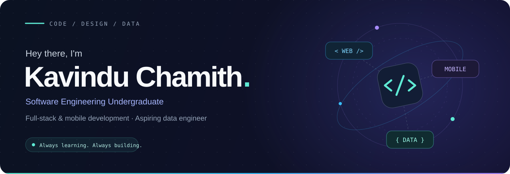
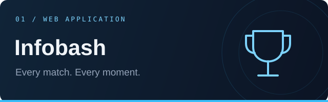
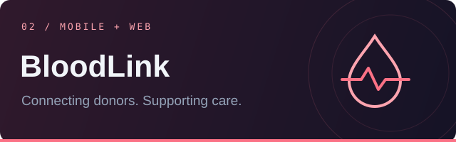
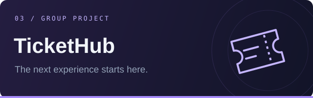

 

**Building useful web and mobile products, learning by shipping, and exploring the world of data.**

 

## About me

I'm a Software Engineering undergraduate at **Sabaragamuwa University of Sri Lanka**, with hands-on experience building full-stack web applications and mobile interfaces. I'm currently expanding my skills through a **Data Engineering Training Programme at ZuuCrew.ai**.

 

## Connect with Me

 

## Featured projects

<table>
  <tr>
    <td width="33%" valign="top">
      
      <h3>Infobash Cricket Tournament</h3>
      
Tournament management platform for team registration, match fixtures, live scoring, results, and event administration.

      
<code>Next.js</code> <code>React</code> <code>TypeScript</code> <code>PostgreSQL</code> <code>Supabase</code>

      
<a href="https://infobash2026.vercel.app"><strong>Explore live project ↗</strong></a>

    </td>
    <td width="33%" valign="top">
      
      <h3>BloodLink</h3>
      
Multi-platform blood donation management system. Working on donor authentication flows and an admin web interface, with interface designs created in Figma.

      
<code>React Native</code> <code>TypeScript</code> <code>Node.js</code> <code>PostgreSQL</code> <code>Firebase</code>

      
<strong>◌ In progress</strong>

    </td>
    <td width="33%" valign="top">
      
      <h3>TicketHub</h3>
      
Online ticket booking platform built as a group project. Contributed account flows, profile management, shared pages, navigation, and Google sign-in.

      
<code>PHP</code> <code>MySQL</code> <code>JavaScript</code> <code>Bootstrap</code> <code>HTML</code> <code>CSS</code>

      
<strong>⌘ Group project</strong>

    </td>
  </tr>
</table>

 

## Tech I work with

<table>
  <tr>
    <td width="50%" align="center">
      <h3>Languages</h3>
      

    </td>
    <td width="50%" align="center">
      <h3>Web &amp; Mobile</h3>
      

    </td>
  </tr>
  <tr>
    <td width="50%" align="center">
      <h3>Backend &amp; Databases</h3>
      

    </td>
    <td width="50%" align="center">
      <h3>Tools</h3>
      
&nbsp; 

    </td>
  </tr>
  <tr>
    <td colspan="2" align="center">
      <h3>Data Engineering</h3>
      

        &nbsp;
        &nbsp;
        &nbsp;
        
      

    </td>
  </tr>
</table>

 

